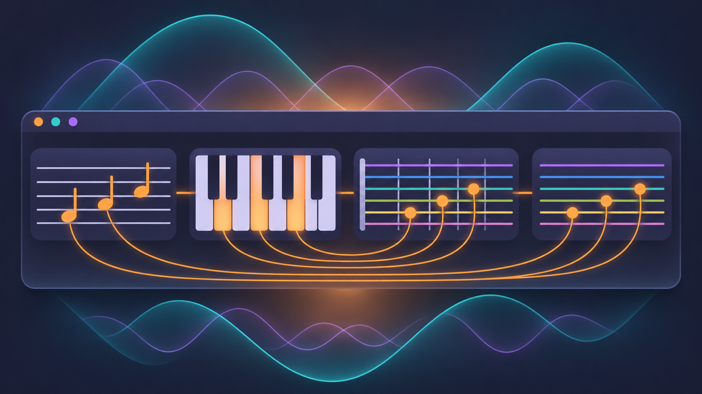
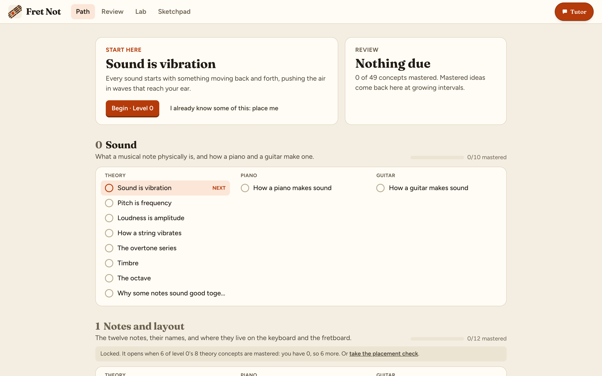
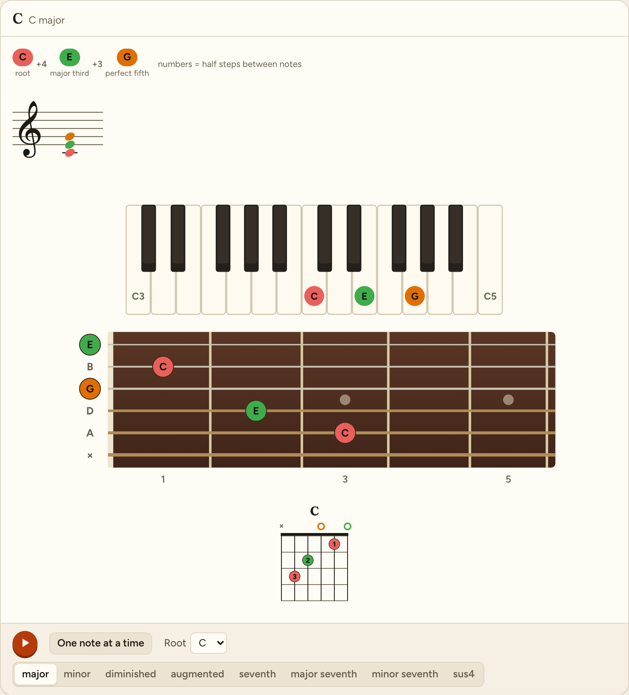
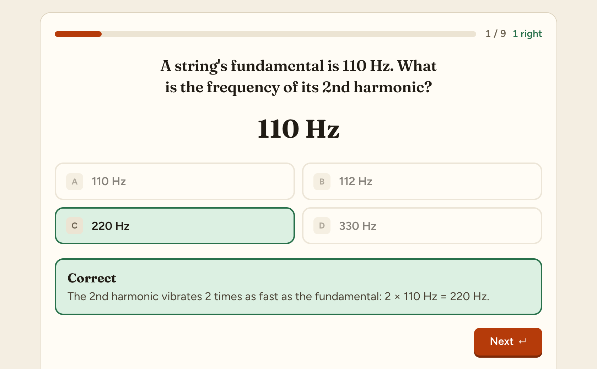
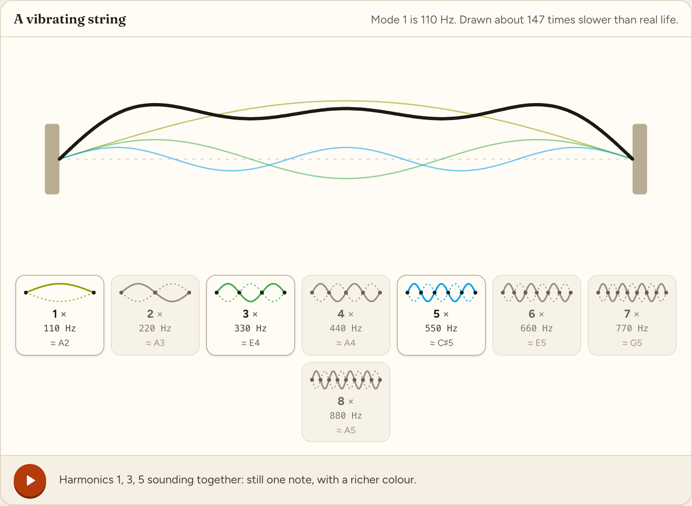
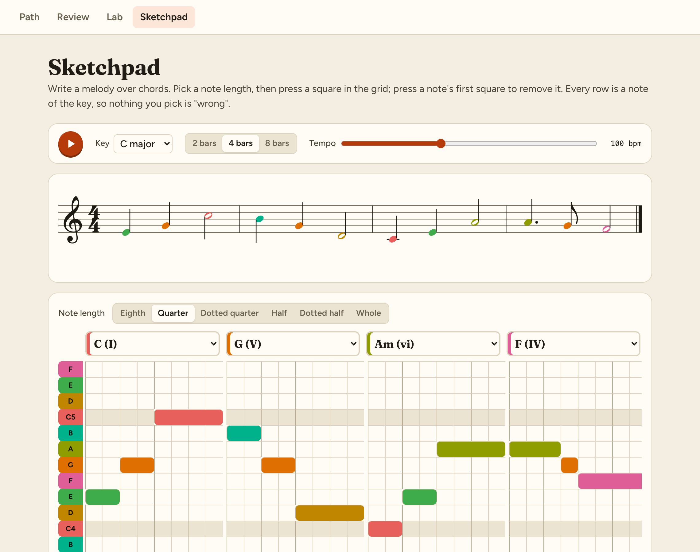
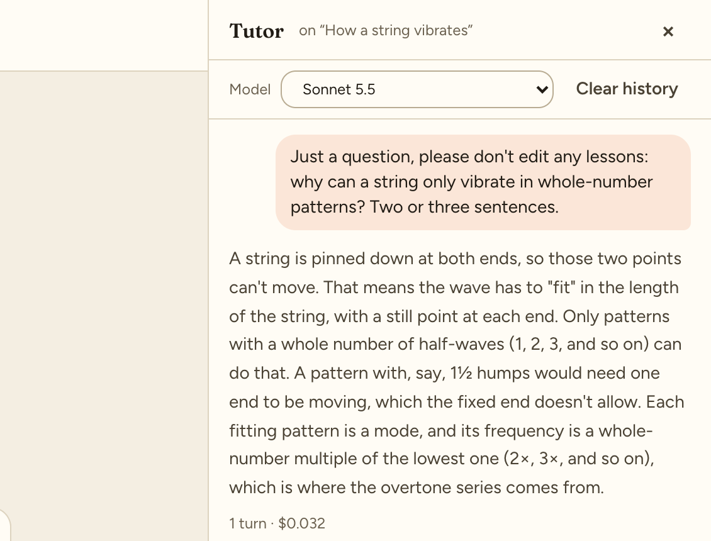

<h1 align="center">Fret Not</h1>

<p align="center"><b>A visual app for learning how music works, on piano and guitar.</b></p>
<p align="center">Sound, notes, rhythm, reading notation, intervals, scales and chords. Every idea is shown, heard and drilled on the instrument.</p>

<p align="center">
  
  
  
  <a href="LICENSE"></a>
</p>

<p align="center">
  
  <br>
  <sub><i>One note, four views: staff, keyboard, fretboard and tab, in sync.</i></sub>
</p>

## Features

<table>
  <tr>
    <td width="50%" valign="top">
      
      <br><sub><i>The Path: level 0, with the next lesson picked for you.</i></sub>
      <h3>A guided path</h3>
      <p>49 short lessons in three linked tracks (theory, piano, guitar) across four written levels: Sound; Notes and layout; Rhythm and reading; Intervals, scales and first chords. Four more levels are outlined.</p>
    </td>
    <td width="50%" valign="top">
      
      <br><sub><i>C major: root, third and fifth lit on every view, one colour per note.</i></sub>
      <h3>Linked views</h3>
      <p>The same notes appear on the staff, the keyboard, the fretboard and in tab or a chord diagram at once, and each pitch class keeps the same colour everywhere.</p>
    </td>
  </tr>
  <tr>
    <td width="50%" valign="top">
      
      <br><sub><i>A practice question, answered and explained.</i></sub>
      <h3>Exercises</h3>
      <p>Generated and graded by a tested music engine: name what you see, ear training, play it on the virtual instrument, build it from a rule, tap a rhythm. Mastery is tracked per concept, with spaced review, level unlocks and a placement check.</p>
    </td>
    <td width="50%" valign="top">
      
      <br><sub><i>Harmonics 1, 3 and 5 sounding together on one string.</i></sub>
      <h3>Interactive physics</h3>
      <p>A vibrating-string simulator, a harmonic mixer, live waveform and spectrum, consonance by frequency ratio, and how each instrument makes its sound.</p>
    </td>
  </tr>
  <tr>
    <td width="50%" valign="top">
      
      <br><sub><i>The Sketchpad: a four-bar melody over C, G, Am and F.</i></sub>
      <h3>Lab and Sketchpad</h3>
      <p>The Lab holds open explorers with nothing scored. The Sketchpad is a place to write a melody over chords, drawn on the staff as you go.</p>
    </td>
    <td width="50%" valign="top">
      
      <br><sub><i>The Tutor, answering a question about the lesson on screen.</i></sub>
      <h3>A Tutor</h3>
      <p>An embedded Claude agent that answers questions about the lesson in front of you and can write new lessons into <code>content/</code>, each change as a git commit. It writes only while <code>content/</code> has no uncommitted changes; otherwise it answers questions and says why it can't edit.</p>
    </td>
  </tr>
</table>

## How it works

Localhost, with logins: an account holds several learners, each with their own progress, Listen settings and Tutor chat, kept in a local Postgres database. Only an admin's Tutor writes lessons. The curriculum is plain markdown and YAML in `content/`, tracked by git. The music engine in `web/shared/music/` is pure TypeScript that runs in the browser, the server and the tests, and every exercise is generated and graded by it, never by the Tutor.

## Get started

Needs Postgres 17 running locally (`brew install postgresql@17 && brew services start postgresql@17`).

```sh
npm install                 # the database tools
npm --prefix web install
npm run db:setup            # once per machine: creates the fret_not database and migrates it
npm run dev                 # http://localhost:38600
```

Open it on the Mac itself and create the first account: it is the admin, and if this copy already had progress under `data/` (from before logins) its first learner starts with it. Add other people with `npm run user -- add <name>`. [`docs/DATA.md`](docs/DATA.md) has the details.

Prefer a Dock icon on macOS? Build the app with `macos/build-app.sh` (needs a working `clang`; see [`macos/README.md`](macos/README.md)).

The Tutor needs the [Claude Code](https://claude.com/claude-code) CLI installed and logged in. Everything else works without it.

## Development

```sh
npm test                  # engine, loader, exercises, progress, tutor, auth (on an in-process PGlite)
npm run check:content     # validate the curriculum
npm run typecheck && npm run lint
```

- [`docs/PRD.md`](docs/PRD.md): what it is and what was decided.
- [`docs/CONTENT.md`](docs/CONTENT.md): how lessons are written. [`docs/CONTENT-REFERENCE.md`](docs/CONTENT-REFERENCE.md): every widget and exercise kind.
- [`CLAUDE.md`](CLAUDE.md): layout and rules for agents working on the code.

## Credits

Music glyphs are set in [Bravura](https://github.com/steinbergmedia/bravura) (SIL Open Font License; see `web/public/fonts/Bravura-OFL.txt`). Instrument samples and their licences are listed in `web/public/samples/CREDITS.md`.

## License

[GNU Affero General Public License v3.0](LICENSE) (AGPL-3.0-only). You may use, change and share Fret Not, but if you distribute it or run a changed version as a network service, you must offer its users the complete source under the same license.

This covers the code and the lessons under `content/`. The bundled font and instrument samples keep their own licences, listed under Credits.

Versions published before 2026-11-16 were released under the MIT license.
